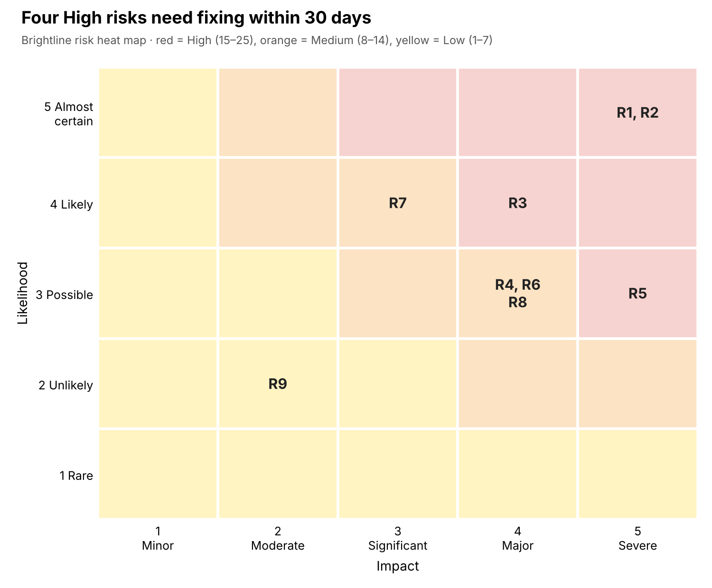
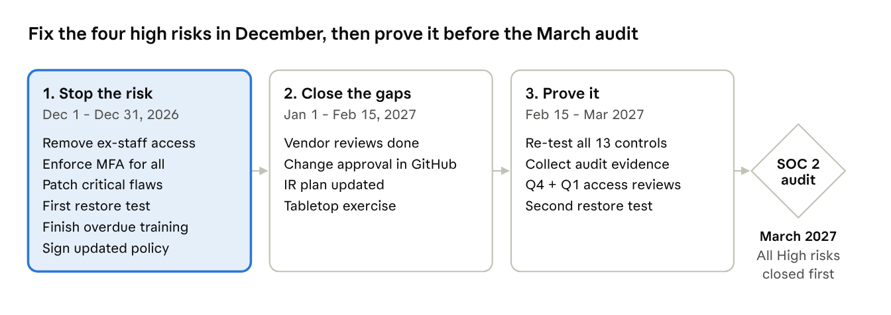

# SOC 2 Readiness Assessment: A GRC Case Study

Built by Astha Patel | M.S. Information Technology, Arizona State University

> **The short version:** I acted as a junior GRC analyst at Brightline Corp, a fictional SaaS company preparing for its first SOC 2 audit. I tested 13 security controls against the company's own policy, using 16 evidence files: access exports, MFA reports, vulnerability scans, change tickets, vendor records and more. **Result: 4 effective, 9 deficient.** One finding was serious enough to escalate immediately: a terminated employee's production account was used 13 days after he left.

---

## The Scenario

Brightline Corp sells scheduling software to about 400 customers, including healthcare networks and a bank. Three major customers said they won't renew without a **SOC 2 Type I report**, and the audit is booked for March 2027. The Head of Security asked one question:

> *"If the auditors tested us today, what would they find?"*

My job: test the controls, find the gaps, score the risks, and tell leadership what to fix before March.

*Brightline is the same fictional company used in my [Safe or Scam? phishing experiment](https://github.com/astha2310/safe-or-scam-phishing-experiment).*

---

## Scope and Method

- **Framework:** SOC 2, Security criteria (Common Criteria), mapped to **NIST CSF 2.0**
- **Evidence date:** November 30, 2026
- **Systems:** Microsoft Entra ID, AWS production, GitHub, CloudNest databases, NetLedger (finance)
- **Approach:** for each control, I identified the policy requirement, inspected the evidence, compared records across files (for example, HR termination dates against current access), and recorded a result with specific evidence: names, dates and counts
- **Sampling:** 15 production changes from October–November 2026

---

## Results: 4 Effective, 9 Deficient

| ID | Control | SOC 2 | NIST CSF 2.0 | Result | Severity |
|---|---|---|---|---|---|
| C1 | Annual policy review and approval | CC5.3 | GV.PO | ❌ Deficient | Low |
| C2 | Quarterly privileged access review | CC6.2, CC6.3 | PR.AA | ✅ Effective | — |
| C3 | Access removed within 1 day of termination | CC6.2 | PR.AA | ❌ Deficient | **High** |
| C4 | MFA on all accounts | CC6.1 | PR.AA | ❌ Deficient | **High** |
| C5 | Security awareness training | CC2.2 | PR.AT | ❌ Deficient | Medium |
| C6 | Quarterly phishing simulations | CC2.2 | PR.AT | ✅ Effective | — |
| C7 | Vulnerabilities fixed within deadlines | CC7.1 | ID.RA | ❌ Deficient | **High** |
| C8 | Production changes approved before deployment | CC8.1 | PR.PS | ❌ Deficient | Medium |
| C9 | Vendor risk assessments and annual SOC 2 reviews | CC9.2 | GV.SC | ❌ Deficient | **High** |
| C10 | Incident response plan reviewed and tested | CC7.4 | RS.MA | ❌ Deficient | Medium |
| C11 | Daily backups and quarterly restore tests | CC7.5 | PR.DS, RC.RP | ❌ Deficient | **High** |
| C12 | Security log retention | CC7.2 | DE.CM, PR.PS | ✅ Effective | — |
| C13 | Encryption at rest and in transit | CC6.1, CC6.7 | PR.DS | ✅ Effective | — |

Full findings with evidence: **[control-testing-worksheet.csv](deliverables/control-testing-worksheet.csv)**

---

## Key Findings

### 🚨 Escalated immediately: a terminated employee's account was used
Comparing the HR termination list against current access showed that **Kevin Brandt**, terminated on October 16, still had AWS production and GitHub access, and **his AWS account logged in on October 29, 13 days after he left**. I escalated this to the Head of Security as a possible incident instead of waiting for the final report. A second former employee still had payment-approval rights in the finance system 24 days after leaving.

### One incident, three gaps
In September, a Sales employee fell for a fake "shared document" page, and an attacker used his mailbox to forward invoices to an outside address. His account had been excluded from MFA since June as a "temporary" exception that was never approved, and **the fix ("enforce MFA") was still open ten weeks later.** That single story connects three failed controls: MFA (C4), incident response (C10) and awareness (C5).

### Judging exceptions, not just finding problems
Several things *looked* wrong but followed the policy, and I documented why each one was acceptable:
- two accounts without MFA had **approved exceptions** with compensating controls
- a critical vulnerability had a **formal CTO risk acceptance**
- an **emergency change** was approved by the CTO within the allowed 24 hours
- two new hires were **still within** their 30-day training window
- an unencrypted storage bucket held **only public website images**, not customer data
- a snack vendor had **no data access**, so vendor-review rules didn't apply

---

## Risk Register

Each deficiency became a risk, scored as **likelihood × impact** (1–5 each), with a treatment plan, an owner and a target date.

| Rank | Risk | Score | Owner | Target |
|---|---|---|---|---|
| R1 | Former employees still have access | 25 High | Head of Security | Dec 2 |
| R2 | Account takeover through accounts without MFA | 25 High | Head of Security | Dec 4 |
| R3 | Exploitation of unpatched critical vulnerabilities | 16 High | Engineering Manager | Dec 7 |
| R5 | Unable to recover data (untested backups) | 15 High | Engineering Manager | Dec 18 |
| R4 | Breach at an unassessed vendor with customer data | 12 Medium | Head of Security + Finance | Jan 15 |
| R6 | Unreviewed code change breaks production | 12 Medium | Engineering Manager | Jan 8 |
| R7 | Slow or chaotic incident response | 12 Medium | Head of Security | Feb 12 |
| R8 | Untrained employees fall for phishing | 12 Medium | Head of People | Dec 31 |
| R9 | Outdated, unapproved security policy | 4 Low | Head of Security / CTO | Dec 15 |

Full register: **[risk-register.csv](deliverables/risk-register.csv)**

---

## Remediation Roadmap

**Verdict for leadership:** not ready today, but ready by March if the four High risks are fixed in December. Full write-up: **[executive summary (PDF)](deliverables/executive-summary.pdf)**

---

## What's in This Repo

| Path | What it is |
|---|---|
| `evidence/` | The 16-file evidence pack: assignment memo, company profile, security policy, system exports and records |
| `deliverables/control-testing-worksheet.csv` | All 13 controls: requirement, evidence, test, result and finding |
| `deliverables/risk-register.csv` | 9 risks: likelihood, impact, score, treatment, owner, target date |
| `deliverables/brightline-soc2-workpapers.xlsx` | Both workpapers in one Excel file |
| `deliverables/executive-summary.pdf` | The report for the CEO and CTO |
| `images/` | Risk heat map and remediation roadmap |

Start with `evidence/00_START_HERE_assignment_memo.md` to follow the assessment from the beginning.

---

## What I Learned

1. **The policy is the rulebook.** Every finding has to point to a specific requirement. "This looks risky" is an opinion; "Policy 3.2 requires removal within 1 business day, and access is 45 days late" is a finding.
2. **The best findings come from comparing records.** No single file showed the terminated-employee problem. It only appeared when HR dates were placed next to access exports.
3. **Not everything that looks wrong is a deficiency.** Checking scope and approved exceptions before writing a finding is what makes an assessment credible.
4. **Severity is a judgment call.** Untested backups looked minor (99.4% of backups succeeded), but no restore test means no proof the company could recover from ransomware.
5. **Leadership needs the answer first.** The executive summary leads with "not ready today, ready by March," then the top risks, then the decisions needed.

---

## Skills Demonstrated

SOC 2 Trust Services Criteria · NIST CSF 2.0 · control testing · audit evidence review · sampling · risk assessment and scoring · risk register · remediation planning · executive reporting · access management (joiner/mover/leaver) · MFA and exception management · vulnerability management SLAs · change management · third-party risk management · incident response governance · backup and recovery

---

## Related Projects

- [Safe or Scam?](https://github.com/astha2310/safe-or-scam-phishing-experiment): human vs. machine phishing experiment, also set at Brightline Corp
- [Vendor Risk Compliance](https://github.com/astha2310/vendor_risk_compliance): vendor risk management solution built with Microsoft Power Platform

---

*Brightline Corp, its people, systems and records are fictional, created for this exercise. Any resemblance to real companies is coincidental.*

Astha Patel | github.com/astha2310 | linkedin.com/in/asthap23
